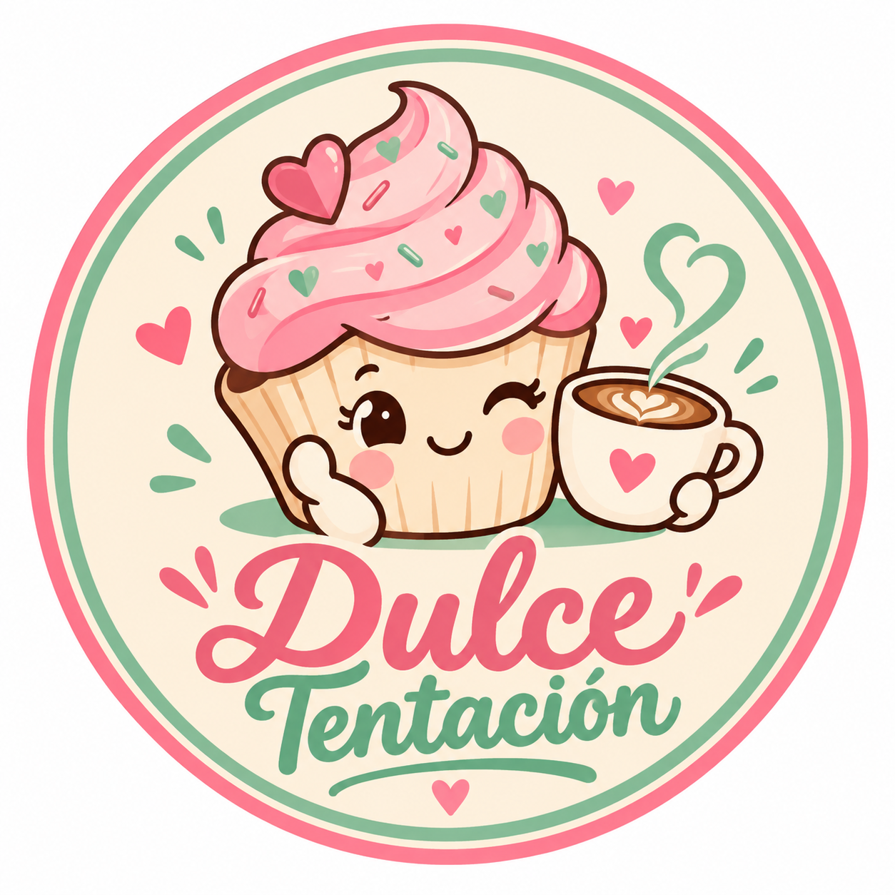

# Estructura del DOM y Certificado SSL · Dulce Tentación

## 1. Certificado SSL / HTTPS (`ssl/` y `.htaccess`)

El proyecto cuenta con certificado autofirmado X.509 de 2048 bits (`SHA-256`) con **Subject Alternative Names (SAN)** para `localhost`, `dulce-tentacion.local` y `127.0.0.1`, junto con redirección automática a `https://`:

- **Certificado público:** `ssl/dulce-tentacion.crt`
- **Clave privada:** `ssl/dulce-tentacion.key`
- **Configuración OpenSSL SAN:** `ssl/openssl-san.cnf`
- **Redirección y cabeceras seguras HTTPS:** `.htaccess` (`RewriteCond %{HTTPS} off` → `https://%{HTTP_HOST}%{REQUEST_URI}` + HSTS + `upgrade-insecure-requests`).

### Direcciones seguras (HTTPS)

- **Tienda de clientes:** `https://localhost/dulce-tentacion/`
- **Portal independiente de Administración y Empleados:** `https://localhost/dulce-tentacion/administracion/`
- **Visualizador interactivo del DOM:** `https://localhost/dulce-tentacion/estructura-dom.html`

---

## 2. Árbol Jerárquico del DOM (`index.html` — Tienda Principal)

```
document
└── <html lang="es">
    ├── <head>
    │   ├── <meta charset="utf-8">
    │   ├── <meta name="viewport" content="width=device-width, initial-scale=1">
    │   ├── <title>Dulce Tentación · Tu pausa más dulce</title>
    │   ├── <link rel="stylesheet" href="css/styles.css">
    │   └── <script src="js/app.js" defer></script>
    │
    └── <body>
        ├── <a class="skip-link" href="#contenido">
        │
        ├── <header class="header wrap">
        │   ├── <a class="brand" href="#inicio">
        │   │   ├── 
        │   │   └── <span>Dulce Tentación</span>
        │   ├── <nav id="menu" class="nav">
        │   │   └── <a> (Inicio, Postres, Cafés, Nosotros)
        │   └── <div class="header-actions">
        │       ├── <button id="open-auth" class="user-trigger"> (#user-label)
        │       ├── <button id="open-cart" class="cart-trigger"> (#cart-count)
        │       └── <button id="menu-toggle" class="menu-trigger">
        │
        ├── <main id="contenido">
        │   ├── <section id="inicio" class="hero">
        │   │   └── <div class="wrap hero-grid">
        │   │       ├── <div class="hero-copy"> (h1, .hero-actions, .hero-stats)
        │   │       └── <div class="hero-visual"> (<figure class="hero-frame">)
        │   │
        │   ├── <section class="categories wrap">
        │   │   ├── <div class="section-heading">
        │   │   └── <div class="category-grid">
        │   │       ├── <article id="postres" class="category-card">
        │   │       └── <article id="cafes" class="category-card">
        │   │
        │   ├── <section class="featured wrap">
        │   │   ├── <div class="section-heading">
        │   │   └── <div id="featured-products" class="product-grid featured-grid">
        │   │
        │   ├── <section id="catalogo" class="catalog wrap">
        │   │   ├── <div class="catalog-top">
        │   │   │   └── <div class="catalog-controls">
        │   │   │       ├── <div class="filters"> (button[data-filter="todos|postres|cafes"])
        │   │   │       └── <label class="search"> (<input id="search" type="search">)
        │   │   ├── <div id="category-banner" class="category-banner" hidden>
        │   │   └── <div id="products" class="product-grid">
        │   │       └── <article class="product-card"> (x20 productos: 14 postres + 6 cafés)
        │   │
        │   └── <section id="marca" class="story wrap">
        │       ├── <div class="story-art">
        │       └── <div class="story-copy">
        │
        ├── <footer class="footer">
        │   ├── <div class="wrap footer-inner">
        │   │   ├── <a class="brand">
        │   │   └── <div class="footer-meta">
        │   │       ├── <nav> (button[data-info="contacto|condiciones|privacidad"])
        │   │       └── <ul class="footer-social">
        │   │           ├── <li><a href="instagram.php"> (Instagram)
        │   │           ├── <li><a href="facebook.php"> (Facebook)
        │   │           ├── <li><a href="https://wa.me/573113617622"> (WhatsApp)
        │   │           └── <li><a class="social-link location-link"> (Call 8 #5-20 parque principal → Google Maps)
        │   └── <p class="prototype-note"> (Copyright en color #9ACDB5)
        │
        ├── <dialog id="product-dialog">
        ├── <dialog id="cart-dialog" class="cart-dialog">
        ├── <dialog id="info-dialog" class="info-dialog">
        ├── <dialog id="auth-dialog" class="auth-dialog">
        └── <div id="toast" class="toast" role="status" aria-live="polite">
```

---

## 3. Árbol Jerárquico del DOM (`administracion/index.php` — Portal Independiente)

```
document
└── <html lang="es">
    ├── <head>
    │   ├── <link rel="stylesheet" href="css/admin.css">
    │   └── <script type="module" src="js/app.js"></script>
    │
    └── <body>
        ├── <main id="access" class="access">
        │   ├── <section class="access-brand">
        │   └── <section class="access-form">
        │       └── <div class="login-card">
        │           ├── <form id="login-form">
        │           │   ├── <input id="login-email" type="email">
        │           │   ├── <input id="login-password" type="password">
        │           │   └── <div class="role-login-actions">
        │           │       ├── <button id="btn-login-admin" data-login-role="administrador">
        │           │       └── <button id="btn-login-empleado" data-login-role="empleado">
        │           └── <p id="login-feedback" role="alert" hidden>
        │
        ├── <div id="panel" class="panel" hidden>
        │   ├── <aside class="sidebar">
        │   │   ├── <nav> (Resumen, Productos y stock, Empleados, Clientes, Movimientos, Roles)
        │   │   └── <div class="sidebar-bottom"> (<button id="logout">)
        │   └── <div class="workspace">
        │       ├── <header class="topbar"> (#active-user-name, #active-user-role)
        │       └── <main class="content">
        │           ├── <div class="page-heading"> (#page-title, #create-record)
        │           └── <div id="view-content"> (Tablas con acciones Editar / Borrar y columna Empleado)
        │
        ├── <dialog id="editor"> (#record-form)
        └── <div id="notification" role="status" aria-live="polite">
```
