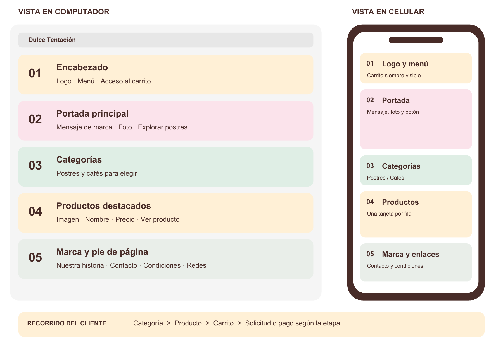

# Estructura del sitio web de Dulce Tentación

Versión local 1.1 con vistas PHP · 26 de octubre de 2026

Este documento relaciona la distribución visual de la propuesta con la estructura real de la página. Sirve como referencia para continuar el desarrollo sin alterar el diseño que Camilo aceptó en esta conversación como «superfiel al manual».

## Base de diseño y estado de aprobación

El manual de identidad «Web y móvil», páginas 12 y 13, es la referencia visual de escritorio y celular. La sección 7 de la propuesta técnica aporta el esquema de organización. Ambos archivos se conservan en la carpeta `referencias` junto a este documento.

La aceptación expresada en esta conversación se registra para el diseño visual de la versión local. No constituye una firma de la propietaria ni aprobación de precios, catálogo, condiciones de venta, integración de pagos o publicación. La propuesta original conserva sus menciones a decisiones pendientes.

## Organización visual de referencia

El gráfico es el esquema conceptual de la propuesta, no una captura del sitio. La web implementada conserva la composición específica de las páginas 12 y 13 del manual. Las capturas `vista-escritorio.png` y `vista-movil.png`, en la carpeta principal, muestran la versión implementada.

## Correspondencia con la página actual

| Bloque | Función visible | Ubicación real en el DOM | Estado y correspondencia |
|---|---|---|---|
| 01 Encabezado | Logo, nombre, navegación y acceso a Mi pedido | Encabezado principal; menú `#menu`; botón `.cart-toggle` | Implementado. En celular el menú se despliega y el acceso al carrito sigue disponible en el encabezado. No es un encabezado fijo durante el desplazamiento. |
| 02 Portada | Mensaje principal, botón Explorar postres y fotografía | Contenido principal `#contenido` → portada `#inicio` | Implementado. Dos columnas en escritorio; texto, botón y foto en vertical en celular. |
| 03 Categorías | Elegir postres o cafés | Enlaces del menú y de la portada; contexto de categoría dentro de `#catalogo` | Integrado en la navegación y el catálogo, sin agregar una franja de categorías que no aparece en la maqueta aprobada. |
| 04 Productos | Tarjetas y acceso a la ficha | Catálogo `#catalogo` → contenedor `#products` → una tarjeta por producto | Implementado con tres productos ilustrativos. Las tarjetas muestran imagen, nombre, descripción breve y botón. Los precios no están confirmados; la ficha indica esta condición. |
| 05 Marca y pie | Mascota, mensaje de marca e información | Sección `#marca`, seguida del pie de página | Implementado. Contacto, condiciones y privacidad abren paneles informativos. Los enlaces sociales reales siguen pendientes. |

La jerarquía general de lectura es: acceso rápido al contenido → encabezado → contenido principal (portada, catálogo y marca) → pie de página. Los paneles se declaran después del pie y se abren solo cuando el visitante los solicita.

## Paneles e interacciones

| Elemento | Contenido y comportamiento | Identificador |
|---|---|---|
| Ficha de producto | Imagen, nombre, descripción, precio pendiente, cantidad y botón de añadir | `#product-dialog` |
| Mi pedido | Productos seleccionados, controles de cantidad, eliminación y resumen; estado vacío cuando no hay productos | `#cart-dialog` |
| Información | Mensajes de contacto, condiciones y privacidad | `#info-dialog` |
| Aviso de resultado | Confirma que se añadió un producto o informa del límite de cantidad | `#toast` |

Las tarjetas, las fichas y las líneas del carrito se generan desde `app.js`. Por ello, el DOM que ve el navegador incorpora estos elementos después de cargar el HTML. Cada producto se identifica por su clave; la selección guarda únicamente esa clave y una cantidad entera de 1 a 99 en el almacenamiento local del navegador.

## Navegación

| Destino | Resultado |
|---|---|
| Inicio | Muestra todos los productos y vuelve al comienzo. |
| Postres | Filtra el catálogo y desplaza la vista a sus resultados. |
| Cafés | Filtra el catálogo y desplaza la vista a sus resultados. |
| Nuestra marca | Lleva a la sección de la mascota y el mensaje de marca. |
| Ver producto | Abre la ficha sin abandonar la página. |
| Mi pedido | Abre la selección guardada en ese navegador. |

Postres y Cafés son estados del catálogo controlados por la navegación, no páginas independientes. No hay checkout, recepción de pedidos, envío por WhatsApp, procesamiento de pagos ni panel administrativo en esta entrega.

## Adaptación responsive

La página usa una sola estructura para todos los dispositivos. Los estilos cambian la distribución sin duplicar el catálogo ni el carrito.

| Ancho | Presentación |
|---|---|
| Más de 760 px | Menú visible, portada en dos columnas y tres tarjetas por fila. Entre 761 y 1050 px se compactan espacios y controles. |
| 760 px o menos | Menú desplegable, portada vertical y una tarjeta por fila. La ficha también pasa a una columna. |
| 410 px o menos | Acceso al pedido compacto. |
| 360 px o menos | Nombre de marca dividido en dos líneas para conservar espacio para el menú. |

La paleta base es rosa fresa `#F58DA9`, verde menta `#9ACDB5` y crema vainilla `#FFF0D6`, con cacao `#482C28` para texto. Se conservan los recursos gráficos aprobados. La tipografía de presentación reproduce la maqueta; la nota de uso de fuente se encuentra en `LEEME.md`.

## Archivos que se editan

| Archivo o carpeta | Responsabilidad |
|---|---|
| `index.php` | Entrada que reúne los bloques mediante rutas PHP fijas. |
| `php/layout/` | Metadatos y recursos en head.php, encabezado.php y pie.php. |
| `php/secciones/` | Portada, catálogo y marca en archivos separados. |
| `php/componentes/` | Paneles de producto, carrito e información. |
| `css/styles.css` | Paleta, tipografía, distribución y estilos responsive. |
| `js/app.js` | Datos ilustrativos, filtros, fichas, cantidades y selección. |
| `assets/img/` | Logo, mascota y fotografía. |
| `assets/fonts/` | Fuente de presentación local. |
| `docs/` | Documentación y referencias conservadas. |

El DOM es el árbol de elementos que recibe el navegador; las carpetas organizan los archivos que lo construyen. PHP reúne las secciones en el servidor y JavaScript completa las tarjetas y los paneles. Esta separación conserva la jerarquía visual y los identificadores documentados arriba.

La versión 1.1 sustituye dist y el lanzador CMD por index.php y las carpetas descritas. Para ejecutarla se necesita un servidor PHP local; las instrucciones están en LEEME.md. No se ha añadido procesamiento comercial de pedidos ni base de datos.

## Comprobaciones y próximos datos

Se comprobó la carga de HTML, estilos, JavaScript y recursos; la sintaxis de JavaScript; la vista en escritorio y en tamaños de celular; y el recorrido de ficha, añadir, cambiar cantidad, eliminar, resumen y persistencia al recargar. También se comprobó el menú móvil y el filtro de cafés. No se ha certificado compatibilidad en dispositivos físicos Safari o Chrome Android ni rendimiento en una conexión móvil real.

Antes de activar ventas se requieren productos definitivos, precios, porciones, ingredientes y alérgenos, disponibilidad, contacto y perfiles sociales, modalidad de entrega y canal de pedido. La administración y el pago en línea dependen de las etapas y decisiones de la propuesta técnica. Mantener esos pendientes separados de la aprobación visual evita atribuir al prototipo funciones comerciales que todavía no tiene.

## Actualización de solicitud por WhatsApp

Se incorporó por solicitud de Camilo un botón verde menta #9ACDB5 en Mi pedido. El formulario está en php/componentes/carrito.php y la preparación del mensaje en js/app.js. El destino es +57 311 361 7622. Se incluyen productos, cantidades, total de unidades, preferencia de entrega y nombre, ubicación e indicaciones cuando se escriben. Para solicitar domicilio se pide ubicación; la cobertura y el costo quedan sujetos a confirmación del negocio. Los datos del formulario no se guardan en localStorage. El botón abre WhatsApp con el mensaje; el cliente lo revisa y lo envía allí. No registra pago ni confirma automáticamente un pedido. Esta actualización sustituye las menciones anteriores a ausencia de apertura de WhatsApp; el catálogo y los precios definitivos siguen pendientes.
